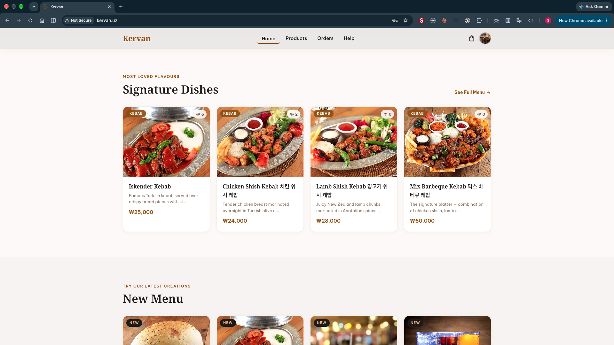
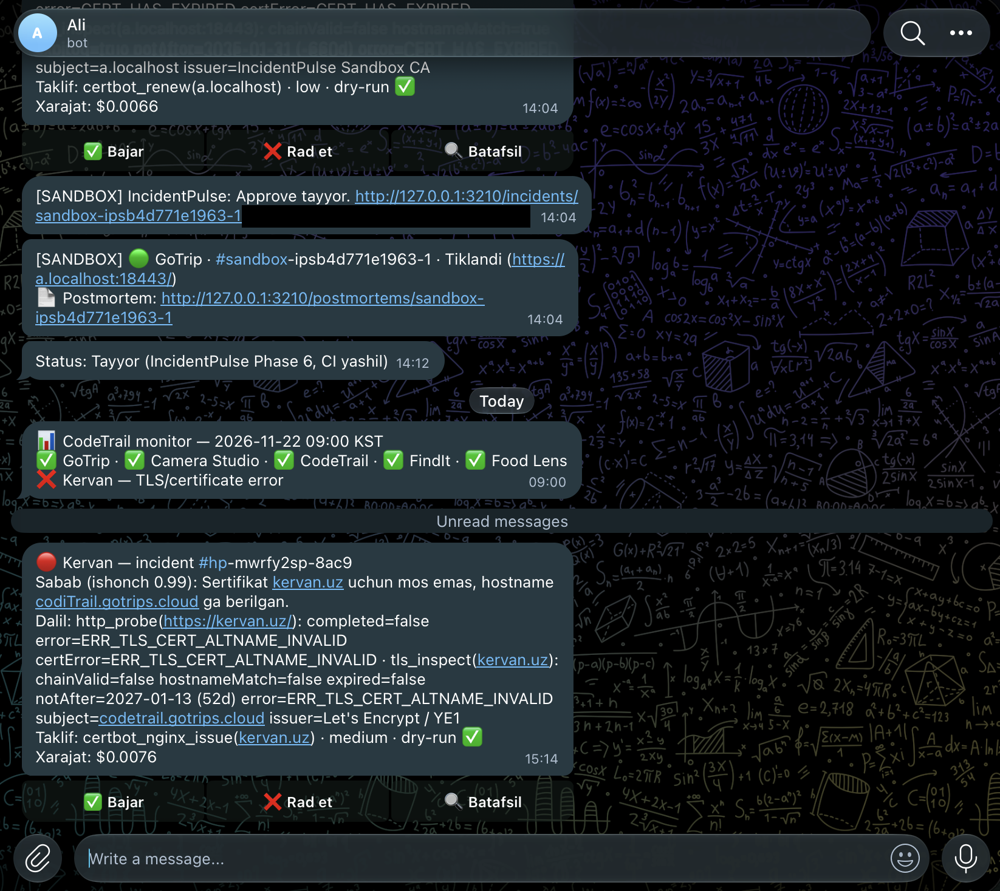
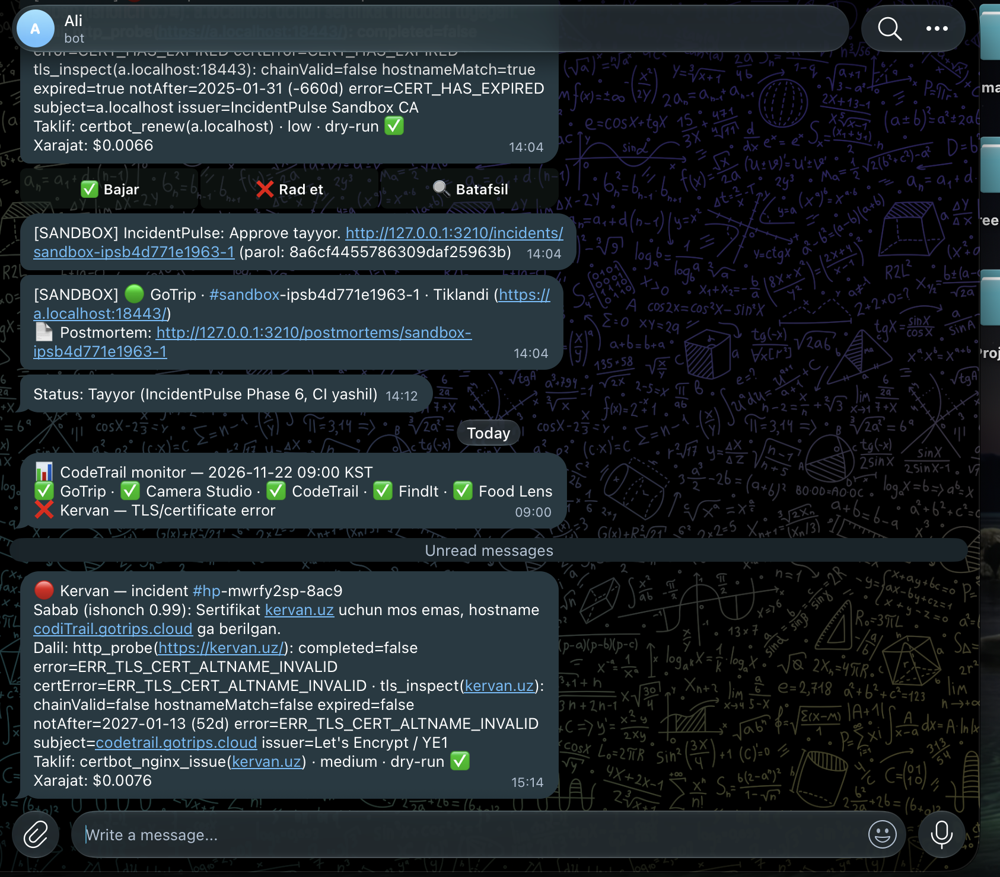
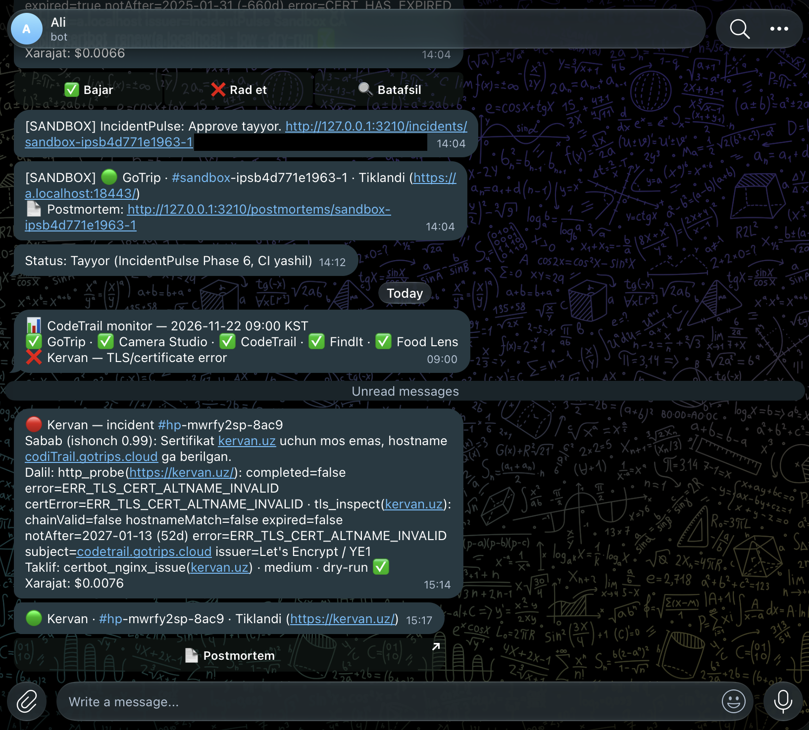
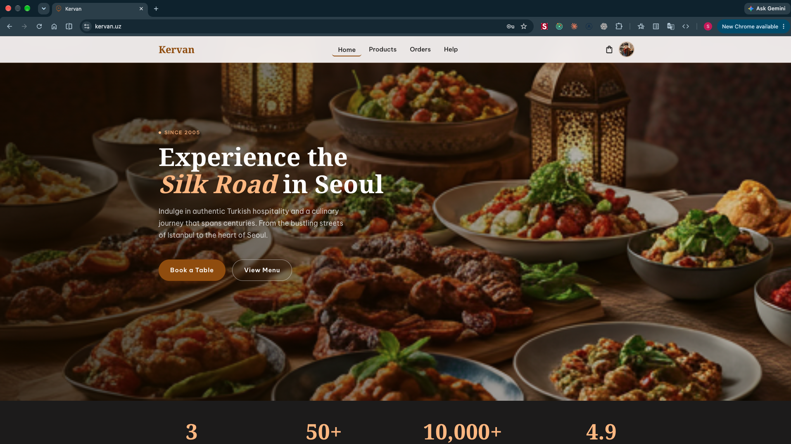

# Case study: the first real incident

**IncidentPulse found, diagnosed and (after one human tap) fixed a broken TLS certificate on a live production site, 3 minutes after the first poll saw it down. That exposed a second fault the system could not see, and the site was fully working again after about 32 minutes. This is the first real incident the system ever handled; everything before it ran against a local sandbox.**

| | |
|---|---|
| Site | `kervan.uz` (one of 6 production apps on a single Ubuntu 24.04 VPS) |
| Symptom | HTTPS unusable: the server answered with another project's certificate |
| Root cause | The nginx vhost for `kervan.uz` listened on port 80 only (no `ssl`), and no certificate had ever been issued for the domain |
| Fix | `certbot --nginx -d kervan.uz --non-interactive --redirect`, approved by a human in Telegram |
| Detection → TLS recovery | about **3 minutes** (15:14 → 15:17 KST), almost all of it spent waiting for the human. This is when `https://kervan.uz` first returned 200 |
| Detection → **full recovery** | about **32 minutes** (15:14 → 15:46 KST): 3 min for the TLS fix, 19 min until a human noticed the site still had no data, 8 min to fix that by hand, 2 min to verify. See [Second finding](#second-finding-mixed-content) |
| Investigation cost | **$0.0076** |
| Collateral damage | none: the other 5 sites kept answering 200 |
| Resulting certificate | valid for 89 days |

IncidentPulse itself had been deployed to that server at 15:13 KST on 2026-11-22 (commit `0eaa635`): 8 services, about 400 MB of RAM in total. The incident was found by its first poll, one minute later. It was not staged.

## Summary

A health poller that makes **no LLM calls** probed all six sites every 15 minutes and found `kervan.uz` down on the very first poll. That opened an incident. The agents investigated with read-only tools (an HTTP probe, a TLS inspection, `nginx -T`, `certbot certificates`), concluded with confidence 0.99 that the vhost had no TLS configuration and no certificate existed, and proposed exactly one runbook from a fixed registry: `certbot_nginx_issue(kervan.uz)`, risk *medium*, with a dry-run that passed.

Nothing was executed until a person pressed **✅ Bajar** ("Do it") in Telegram. A host-side runner, a separate Unix user restricted by a sudoers file of 20 exact commands, then issued the certificate and reloaded nginx. A recovery probe saw `https://kervan.uz` return 200, the incident closed as recovered, and a postmortem was written. Five minutes later, the independent poller confirmed the site was healthy.

The site was also reachable over plain HTTP the whole time, only HTTPS was broken, which is the kind of failure that is easy to miss by eye:

| Before the fix, over HTTP (14:20 KST) | |
|---|---|
|  |  |

The existing CodeTrail morning monitor had also flagged it (`❌ Kervan — TLS/certificate error`, 09:00 KST, visible in the Telegram screenshots below). It reported the problem but could neither explain it nor fix it, and the error was still there when IncidentPulse was deployed at 15:13.

## Timeline

All times are KST (UTC+9), 2026-11-22.

| Time | Event |
|---|---|
| 15:13 | IncidentPulse deployed to the VPS (commit `0eaa635`): 8 services, about 400 MB RAM |
| 15:14 | First poll of the LLM-free health poller: `kervan.uz` is **Down**. Incident `hp-mwrfy2sp-8ac9` opens |
| 15:14 | Investigation: `http_probe` and `tls_inspect` → `ERR_TLS_CERT_ALTNAME_INVALID`; `nginx -T` and `certbot certificates` read. Root cause at confidence 0.99. Proposal `certbot_nginx_issue(kervan.uz)`, risk medium, dry-run ✅. Cost $0.0076. Telegram message with **Bajar / Rad et / Batafsil** buttons |
| ~15:17 | The human taps **✅ Bajar** |
| ~15:17 | Host runner executes `certbot --nginx -d kervan.uz --non-interactive --redirect`, then `nginx -t` → ok |
| 15:17 | Recovery probe: `https://kervan.uz` → **200**. 🟢 Tiklandi (recovered) message, postmortem generated |
| 15:21 | The independent health poll confirms: "Kervan — qayta ishlayapti" (working again). It was checking only the home-page status code |
| 15:36 | **Second fault found by a human**, by opening `https://kervan.uz` in a browser: the page loads but shows no data ("No signature dishes yet!"). Cause: mixed content, the frontend still calls `http://kervan.uz:3003` |
| 15:44 | Fixed by hand: nginx TLS proxy on port 8443 (with WebSocket upgrade), `REACT_APP_API_URL=https://kervan.uz:8443`, backend `FRONTEND_URL=https://kervan.uz`, frontend rebuilt |
| 15:46 | Verified in the browser: data loads, login works, the cart works. **Full recovery: ~32 minutes after detection** |

## Evidence

The agents were only allowed to look. Their conclusion rests on four read-only observations, each cited by the report:

1. **HTTP probe.** `https://kervan.uz/` did not complete: `error=ERR_TLS_CERT_ALTNAME_INVALID`.
2. **TLS inspection.** The server presented a chain that was cryptographically fine but for the wrong name: `chainValid=false`, `hostnameMatch=false`, `expired=false`, `notAfter=2027-01-13 (52d)`, `subject=codetrail.gotrips.cloud`, `issuer=Let's Encrypt / YE1`. The certificate was not expired; it simply belonged to a different project on the same server.
3. **nginx configuration (`nginx -T`).** A `conf.d/kervan.conf` existed, with `listen 80` only: no `listen 443 ssl`, no certificate paths.
4. **certbot.** `certbot certificates` listed no certificate for `kervan.uz`.

That combination rules out the usual suspects (expiry, a stopped container, a DNS problem) and points to a vhost that was never upgraded to TLS. It also determined the *right* runbook: there was no certificate to renew, so the system proposed issuing one (`certbot_nginx_issue`) instead of `certbot_renew`.

The proposal as Telegram showed it (the bot's messages are in Uzbek: *Sabab* = cause, *Dalil* = evidence, *Taklif* = proposal, *Xarajat* = cost):



## Human approval

Nothing in the pipeline can change the server without a person. The proposal arrives with three buttons:

- **✅ Bajar**: approve and execute
- **❌ Rad et**: reject
- **🔍 Batafsil**: open the full evidence and reasoning

Pressing Approve mints a single-use HMAC token bound to this incident, this project, this runbook and these exact parameters. It expires after 15 minutes and is consumed atomically in Postgres, so a repeated or replayed tap cannot run the command twice. Only the Telegram user IDs on the allowlist (checked server-side) can approve.

Two details worth noting: the runbook was marked *medium* risk, because it edits a live nginx configuration, and the dry-run had already passed before the question was asked. The decision took roughly two to three minutes, which is the dominant part of the whole incident and exactly the part that should stay human.

After the tap the buttons disappear (an approval can only be used once) and the system executes:



## Execution and audit

The orchestrator never runs commands itself, and no LLM ever sees the execution tool. The approved action goes to a small **host runner** that sits on a Unix socket:

- it runs as a **separate Unix user**, not as the orchestrator's user;
- `sudoers` grants that user **20 exact commands**, with fixed arguments, and nothing else;
- the commands are executed as fixed argument arrays (`execFile`, no shell), with parameters validated against exact per-project values.

For this incident it ran, in order:

```
certbot --nginx -d kervan.uz --non-interactive --redirect
nginx -t        # ok
```

The audit trail has two layers: the application's audit table (decision, token claim, execution result) and the **sudo journal** on the host, so what actually ran as root is recorded by the operating system and not only by the application that asked for it.

## Verification

Success is not "the command exited 0". After execution the system re-probes the site itself:

- **15:17**: recovery probe `https://kervan.uz` → **200**. The incident closed as recovered, and a postmortem was generated.
- **15:21**: the independent health poller, a separate component from the incident pipeline, polled again and confirmed the site was healthy.
- The other **5 production sites** answered 200 throughout: no collateral damage.
- The new certificate is valid for **89 days**.
- Caveat: both checks only look at the status code of the home page. That passed, and it turned out not to be the whole story (next section).




## Second finding: mixed content

The TLS fix was correct and the incident was closed as recovered, but **the site was still broken for real users.** Opening `https://kervan.uz` now worked, yet the page had no data: the "Signature Dishes" section showed *"No signature dishes yet!"*.

**Cause.** The frontend was built with `REACT_APP_API_URL=http://kervan.uz:3003`, and the Socket.IO client uses the same address. Over HTTP that worked. Once the page was served over HTTPS, the browser treated every call to `http://kervan.uz:3003` as mixed content and blocked it, so no API request and no WebSocket connection ever left the page. Before the fix nobody could have seen this: the browser was loading the site over plain HTTP, where the same URLs were allowed. In other words, fixing TLS exposed a second fault that had been hidden behind the first.



**IncidentPulse did not notice.** The poller's definition of healthy is "the home page returns 200", and it did: the HTML shell of a single-page app loads fine whether or not its API calls succeed. So the recovery probe (15:17) and the independent poll (15:21) both reported success while users saw an empty menu. The agent's scope ended where its tools ended: it diagnosed and repaired the thing it could see, the certificate, and had no way to know that the page was unusable. I found this by opening the site in a browser, not through any alert.

**Fixed by hand, not by the agent.** There is no runbook for this and I did not add one on the spot:

1. nginx: a TLS reverse proxy on port **8443** using the `kervan.uz` certificate, forwarding to the backend at `127.0.0.1:3003`, with the WebSocket `Upgrade` headers so Socket.IO keeps working;
2. frontend: `REACT_APP_API_URL=https://kervan.uz:8443`;
3. backend: `FRONTEND_URL=https://kervan.uz`, so its allowed origin matches the new scheme;
4. the frontend was rebuilt, because `REACT_APP_*` values are baked in at build time.

**Time to full recovery: about 32 minutes** (15:14 → 15:46). The TLS fault was fixed at 15:17; the mixed-content problem was found at 15:36 by opening the site in a browser, fixed by hand at 15:44, and confirmed at 15:46 in the browser (data loads, login and the cart work). So the system's part (3 minutes) is a small fraction of the real outage: **19 of the 32 minutes passed after IncidentPulse had declared the site recovered and before anyone noticed it was not**.

## What went well

- **Detection needed no LLM.** The poller is plain HTTP checks on a timer, so a model outage or a budget cap cannot blind it, and a healthy fleet costs $0.
- **The diagnosis was specific, and right.** Wrong certificate, vhost without TLS, nothing to renew: each claim cites an evidence item, and the chosen runbook matches that distinction.
- **It was cheap.** $0.0076 for the investigation, in line with the $0.0083 mean measured on the sandbox eval.
- **The human stayed in the loop without slowing the machine.** The system did everything up to the decision in under a minute; the person only had to read one message and tap one button.
- **The blast radius was small by construction.** One runbook, one domain, 20 allowed commands, a single-use token. The other five sites were never touched.
- **Verification was independent**, in the sense that the system checked the result itself and a second component confirmed it. What they checked was too narrow, see below.

## What didn't go well

- **The agent fixed the right thing and still left the site broken.** Its view of the world is its tool set: HTTP status, TLS, nginx, certbot. Within that view it was correct and well-evidenced. Outside it, there was a second fault it could not see, and "recovered" was declared on a definition of health that was too thin.
- **"Recovered" meant "the home page returned 200".** That check cannot tell a working single-page app from an empty shell. The incident closed, the postmortem was written, and the Telegram message said 🟢. The 3 minutes is for the TLS fault only; the honest figure for the user-visible outage is about 32 minutes, and 19 of them were spent with a green "recovered" status.
- **The second fault was found by a human with a browser.** The monitoring system that was supposed to remove that need did not.
- **"No collateral damage" needs a qualifier.** It holds for the other five sites; Kervan's own users saw an empty site from the TLS fix at 15:17 until the manual fix at 15:44 (before 15:17 HTTPS did not work at all, but plain HTTP did).

## What we fixed during rollout

The deploy found real problems that the sandbox could not. They are listed because they are the point of running on a real server:

1. **A wrong "no vhost" conclusion in my own deploy guide.** `DEPLOY.md` first inspected only `sites-enabled/`, found nothing for Kervan, and concluded that no vhost existed. The vhost lived in `conf.d/`. Following the guide would have created a **duplicate server block** for `kervan.uz`. The inventory now uses `nginx -T`, which prints the configuration nginx actually loaded, wherever it came from, and creating a second block for an existing domain is explicitly forbidden.
2. **Port 3000 was already taken: by Kervan.** The dashboard would have collided with a production app. The web UI now listens on **3100**.
3. **`umask 077` broke the runner.** A restrictive umask during setup left files unreadable to the runner's Unix user, so the host runner failed to start. Fixed in the deploy steps.
4. **The Node archive was owned by uid 1000.** A binary executed by root through sudo must not be writable by an unprivileged user, otherwise that user can get root. Ownership was moved to `root`.

Items 3 and 4 are the kind of issue that only shows up when a privileged helper meets a real, lived-in machine; item 1 is a reminder that the documentation I wrote can be wrong in the same way a model can be.

## Follow-ups

- **Deep health checks (first priority): done (2026-11-22).** The poller now has a second, slower LLM-free check (every 60 minutes, at start, and at once when a Down project comes back). It fetches the home page and flags any `http://` in `<script src>`, `<link href>` and ``; it downloads the project's own JS bundles (each ≤ 5 MB, all ≤ 10 MB, with a timeout) and flags `http://` and `ws://` URLs that point at the project's domains or the server's IP; and an optional `HEALTH_DEEP_JSON` lists API URLs with the statuses that count as healthy (for Kervan: `https://kervan.uz:8443/<endpoint>`, `[200, 401]`). A finding makes the project **Degraded** (the page answers 200 but is not usable), with the categories `mixed_content` and `api_down`. There is no runbook for them, so they always escalate: a short Telegram message names the URL and the file, with no proposal and no LLM, and at most one reminder per day while nothing changes. Sandbox scenarios 15 and 16 reproduce both faults, and the real checker detects them for $0 ([sandbox/results/deep-health.json](../sandbox/results/deep-health.json)). Against this incident it would have cut the 19 minutes between the TLS fix and the human finding to at most the deep interval, and usually to minutes, because a Down project that comes back is deep-checked immediately. It is a string scan, not proof that a request is made, so a harmless `http://kervan.uz/...` string in a bundle is reported too. **Still open:** the API check looks at the status only (no non-empty-body check), and the headless-browser check that watches for blocked requests, which would catch this class of fault directly, is not built. It has not run on the real server yet; the rollout steps are in [DEPLOY.md, section 11](DEPLOY.md).
- **Long term: `api.kervan.uz`.** Serve the API on a subdomain with its own certificate on port 443, instead of a custom port behind a second TLS proxy. The `:8443` setup is a workaround that works but adds a non-standard port to every URL.
- **Close the raw ports on the firewall.** Block ports **3000** and **3003** from the outside in UFW, so the backend is reachable only through nginx. Until then the old plain-HTTP address of the backend is still open to the internet.
- **A typo in the model's prose.** The cause sentence says "codiTrail.gotrips.cloud"; the evidence beside it spells `codetrail.gotrips.cloud` correctly. Cosmetic, but a human reading the summary should be able to trust it. The next step is to quote hostnames from evidence verbatim instead of retyping them, and to add a check that any hostname in the prose also appears in the evidence.
- **Make the approval wait visible.** About 3 minutes of detection → TLS recovery is almost entirely the person. Worth measuring per incident, and considering a reminder when a proposal sits unanswered.
- **One real incident is an anecdote.** It shows the loop works on real infrastructure; it is not a success rate. The 14-scenario eval remains the only broader measurement.
- **Not covered by this incident:** the transient exit, escalation, a rejected proposal, and a repair that fails verification.

## Reading list

- [README](../README.md): architecture, evaluation, cost, safety
- [docs/DEPLOY.md](DEPLOY.md): the production deploy
- [docs/REVIEW-phase7.md](REVIEW-phase7.md): the pre-deploy review
- [docs/RESUME.md](RESUME.md): the numbers behind the claims
