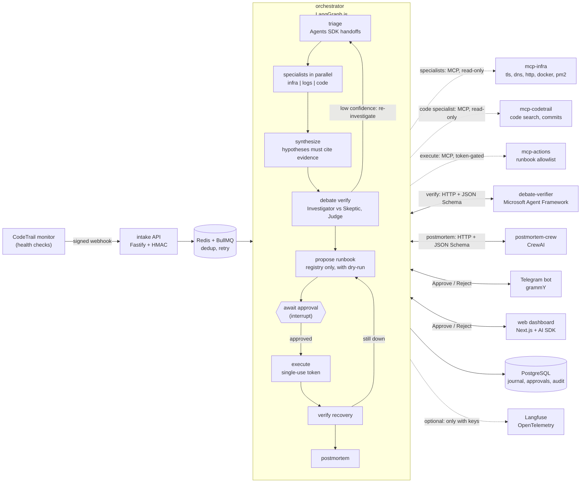

# Architecture

The authoritative design (graph state, nodes, agents, MCP servers, budgets, evals) is [SPEC.md](SPEC.md). Each framework
choice is explained in [adr/](adr/). This page is the picture of what is built as of Phase 6.

## Graph nodes

| Node | What it does | LLM? |
|---|---|---|
| `intake` | Normalises the monitor signal (strips injection-looking lines), checks the weekly budget | no |
| `transient` | Every fixed probe is healthy again, so the incident closes without investigation (flapping) | no |
| `triage` | Agents SDK agent hands off to infra / logs / code specialists and may not conclude | yes |
| `investigate` | One run per chosen specialist in parallel (LangGraph `Send`), each with its own read-only MCP server | yes |
| `join`, `synthesize` | Merge evidence deterministically; rank hypotheses that must cite real evidence ids | yes (synthesize) |
| `verify`, `reinvestigate` | Debate verifier (Python); below 0.7 confidence the graph investigates again, at most 3 times | yes |
| `propose` | Picks one runbook from the registry (or none) and runs its dry run | yes |
| `request_approval`, `await_approval` | Telegram and web buttons; `interrupt()` until a human decides or 60 minutes pass | no |
| `execute`, `verify_recovery` | Single-use token, fixed argv, then the same health probes again; one more attempt if still down | no |
| `close`, `report`, `escalate` | Final message; the postmortem service runs after a recovery or an escalation | no |

## Observability

Langfuse tracing is optional. With `LANGFUSE_PUBLIC_KEY` and `LANGFUSE_SECRET_KEY` set, one trace per incident holds a span per
node, a generation per LLM call (tokens and computed cost) and a tool observation per MCP call, all redacted. Without the keys
nothing is loaded or sent ([ADR-007](adr/ADR-007-langfuse-opentelemetry.md)).
